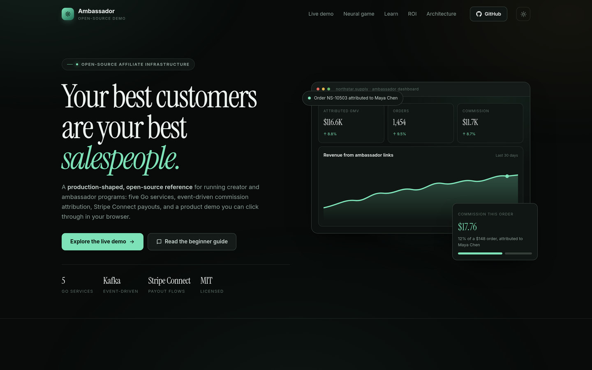
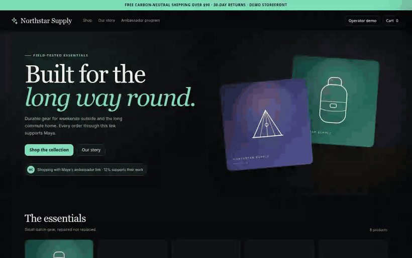
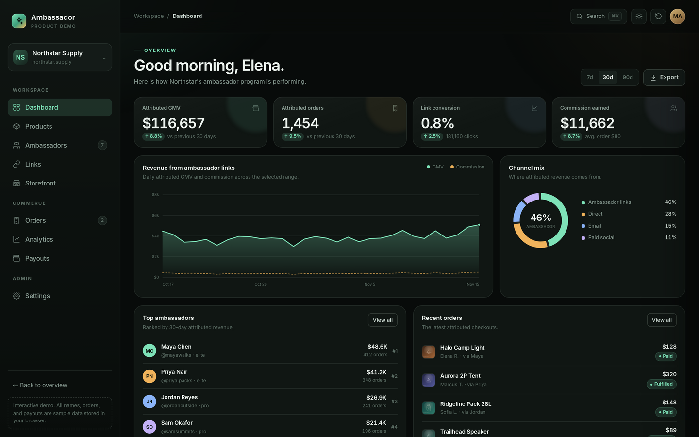
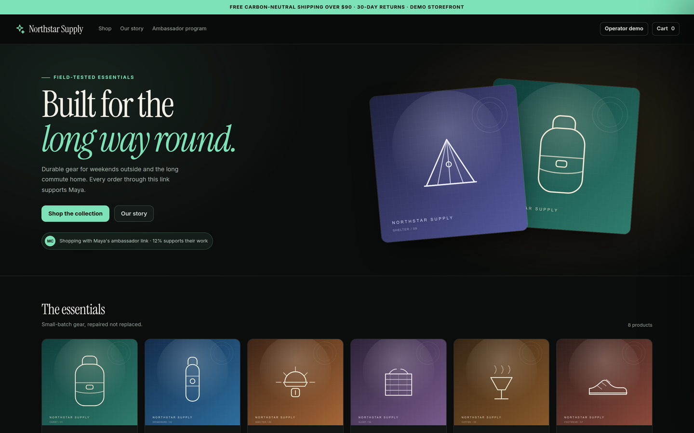
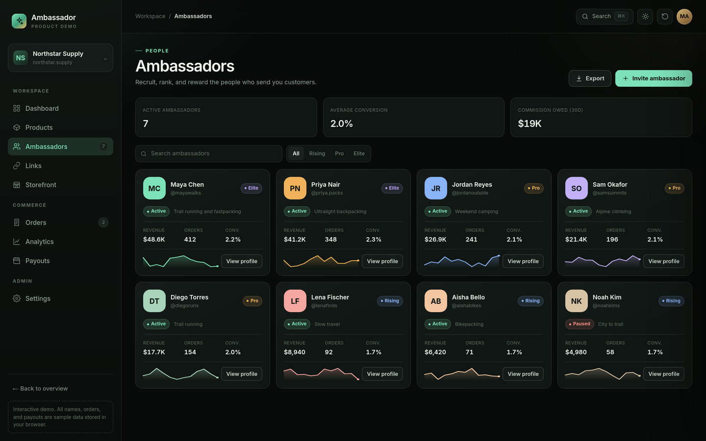
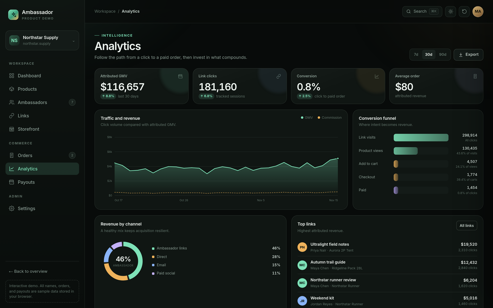
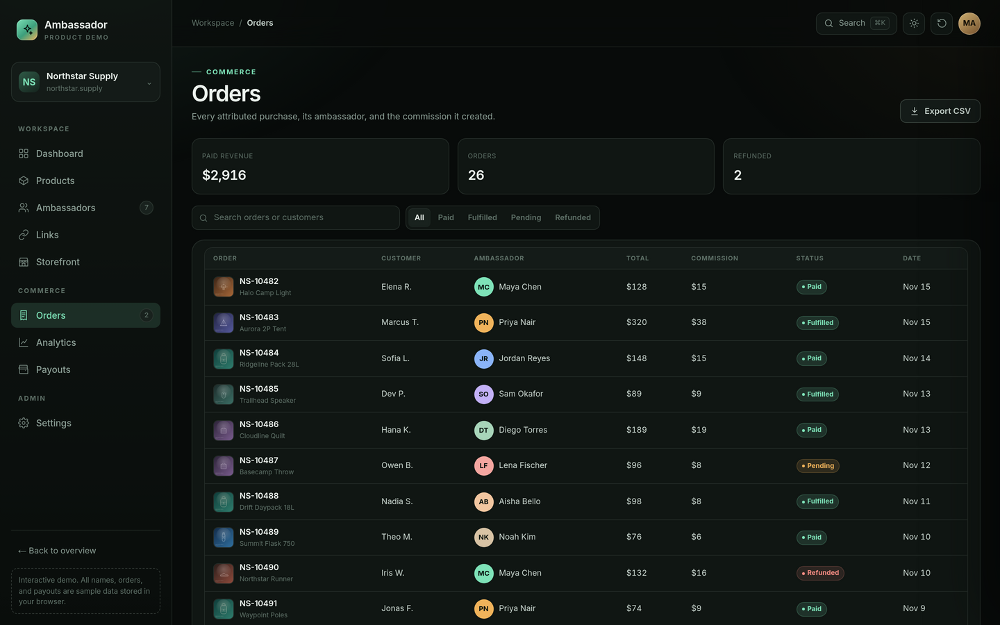
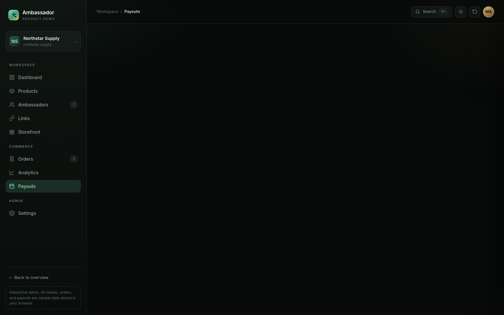
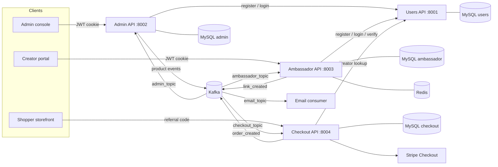

<div align="center">

# Ambassador

### An open-source creator program your finance team can audit.

Five Go microservices for affiliate and ambassador programs — products, referral links, attributed orders, commissions, and an event-driven backbone — plus a product demo you can click through in your browser.

[](https://github.com/M0-AR/ambassador-microsevices-golang/actions/workflows/ci.yml)
[](https://github.com/M0-AR/ambassador-microsevices-golang/actions/workflows/codeql.yml)
[](LICENSE)
[](https://go.dev)
[](https://github.com/M0-AR/ambassador-microsevices-golang/releases/tag/v1.0.0)

**[Open the interactive demo](https://m0-ar.github.io/ambassador-microsevices-golang/)** &nbsp;·&nbsp; [Dashboard](https://m0-ar.github.io/ambassador-microsevices-golang/app/dashboard.html) &nbsp;·&nbsp; [Storefront](https://m0-ar.github.io/ambassador-microsevices-golang/app/storefront.html) &nbsp;·&nbsp; [Read 🌱 Beginner guide](#-beginner-guide--read-this-and-you-are-a-professional)



</div>

---

## The short version

Ambassador is a working reference implementation of the software behind a creator or affiliate program.

A merchant publishes a catalog. Each creator receives a personal referral link. When a shopper buys through that link, checkout records the order, attributes it to the creator, and splits the line-item revenue **90% to the merchant and 10% to the creator**. A Kafka event then fans out to three consumers: the admin service updates its view of the order, the ambassador service updates creator stats and rankings, and the email consumer sends the receipts.

Everything is written in Go with Fiber, MySQL, Kafka, Docker, Kubernetes manifests, and GitHub Actions. The repository is deliberately small enough to read in an afternoon and structured enough to show how the pieces fit together in production.

> **This is a reference, not a hosted product.** The APIs, database models, payment session, and event pipeline are real code. The nine polished screens in the demo are a client-side simulation so you can understand the product without installing anything. The next section draws that line precisely.

### Why business people should care

- **Acquisition through people, not just ads.** A creator program turns existing customers and niche experts into a measurable acquisition channel.
- **Attribution you can inspect.** Every commission traces back to a link, an order, and a line item — not a spreadsheet exported from a black box.
- **Failure isolation.** Email outages, analytics lag, or an admin dashboard restart never block a checkout, because work is decoupled through Kafka.
- **No vendor lock-in.** MIT licensed. Fork it, replace Stripe, swap MySQL, or run it on any Kubernetes cluster.
- **A demo that does not lie.** The demo is labeled as a simulation; the README separates what runs from what is mocked.

### Why engineers should care

- Five independently deployable services with clear ownership boundaries.
- Real Kafka producers and consumers, including a consumer that turns events into email.
- JWT authentication with a users service acting as the identity authority.
- Multi-stage, non-root production images; Compose stacks; Kubernetes manifests; CodeQL; CI.
- A public OpenAPI contract, honest limitations, and a beginner guide that explains every concept from first principles.

---

## See it in action

The demo is a complete, clickable product tour: dashboard, catalog, creators, links, storefront, orders, analytics, payouts, and settings.



| Dashboard | Storefront |
| --- | --- |
|  |  |
| **Creators** | **Analytics** |
|  |  |
| **Orders** | **Payouts** |
|  |  |

**[Launch the demo →](https://m0-ar.github.io/ambassador-microsevices-golang/)** It also includes a 3D neural-network explainer with narration, a six-question quiz, an ROI calculator, and an interactive architecture map.

---

## What is real, and what is a demo

Trust is a feature. This table is the contract between the repository and you.

| Capability | Status |
| --- | --- |
| **Nine product screens** (dashboard, catalog, creators, links, storefront, orders, analytics, payouts, settings) | **Simulated** in the browser with sample data in `localStorage`. No backend calls. |
| **Users, Admin, Ambassador, Checkout APIs** | **Real** Go/Fiber services with handlers, middleware, and GORM models. |
| **MySQL persistence** | **Real.** Each service owns its own database schema. |
| **JWT authentication** | **Real.** The users service issues a signed cookie; admin and ambassador verify it through the users service. |
| **Stripe Checkout session** | **Real**, in test mode. Keys come from the environment. |
| **Payment confirmation** | **Partial.** The storefront posts the Checkout Session id to `/api/checkout/orders/confirm`, which marks the order complete and publishes events. Signed Stripe webhook verification is **not** implemented yet. |
| **Commission calculation** | **Real but simple.** A flat **10%** of each line-item total for the ambassador and **90%** for the merchant. |
| **Tiered rates and payout batches** | **Demo only.** The payouts screen shows what a richer program could look like; the Go services do not implement transfers yet. |
| **Kafka events** | **Real.** Producers and consumers use `confluent-kafka-go`. |
| **Transactional email** | **Real** SMTP consumer, configured through environment variables. |
| **Docker, Compose, Kubernetes** | **Real artifacts**, built and validated in CI. The manifests are a reference deployment, not a hardened production platform. |
| **Automated Go tests** | **Not yet.** CI runs build, vet, test, and format checks; the tree currently has no `_test.go` files. This is the first item on the roadmap. |

If you need the short version: **the demo explains the product; the Go code is the product.** Nothing in the demo charges a card, sends an email, or writes to MySQL.

---

## 🌱 Beginner guide — read this and you are a professional

New to microservices, Kafka, or affiliate programs? Read this section top to bottom. It assumes no prior knowledge. At the end, you will understand every moving part in this repository. **You will know more than most interview candidates.**

### 1. The business idea in one example

Maya is a fitness creator. A jacket brand sells a $100 jacket on its store.

1. The brand invites Maya to its ambassador program.
2. Maya gets a personal link: `https://shop.example/store?code=MAYA10`.
3. Maya posts the link. A follower clicks it and buys the jacket.
4. The software remembers that the visit came from Maya's code.
5. The order is recorded as **$90 for the brand and $10 for Maya**.
6. Maya sees the sale in her dashboard. The brand sees it in the admin console.
7. When the payment completes, an email tells Maya she earned $10.

That is an affiliate or ambassador program. The rest of this repository is the machinery that makes those seven steps reliable.

### 2. What a referral link actually is

A referral link is an ordinary URL with a short code attached — here, `?code=MAYA10`.

The ambassador service stores a row in its `links` table containing the code, the creator's user id, and the product being promoted. Nothing secret is hidden in the URL. The code is simply a lookup key.

When the storefront loads, it asks checkout: "What is behind `MAYA10`?" Checkout returns the product and creator. That is why a creator can share one link and still have the order attributed correctly.

### 3. What happens when someone buys

Here is the real sequence in this codebase:

1. The shopper opens the storefront with a `code` in the URL.
2. The storefront calls `GET /api/checkout/links/:code` to resolve the link.
3. The shopper fills in name, email, and address and submits the cart.
4. The storefront calls `POST /api/checkout/orders`.
5. Checkout validates the link, writes an order and one order item per product, and calculates the 90/10 split.
6. Checkout asks the users service for the creator's email, then creates a **Stripe Checkout Session**.
7. Stripe hosts the payment page. The shopper pays with a test card.
8. Stripe redirects the shopper back to the storefront's success page.
9. The storefront calls `POST /api/checkout/orders/confirm` with the Checkout Session id.
10. Checkout marks the order complete and publishes `order_created` to three Kafka topics.
11. Admin, ambassador, and email consumers each react in their own time.

Step 9 is the honest weak point: a production system should verify a signed Stripe webhook instead of trusting a browser call. The code is written so that this can be replaced cleanly.

### 4. What a microservice is

A microservice is a small program with one clear job, deployed on its own.

This repository has five:

- **Users** answers "who is this person?" and issues login tokens.
- **Admin** answers "what is in the catalog, and what did we sell?"
- **Ambassador** answers "what links exist, and how is each creator doing?"
- **Checkout** answers "what is in this cart, and did the payment happen?"
- **Email** answers "what should we tell people about this order?"

Each service has its own database. That is deliberate. If the catalog team changes a product table, they cannot accidentally break login. The trade-off is that services must communicate explicitly — through HTTP for immediate questions and Kafka for events.

### 5. What Kafka is, in plain words

Kafka is a durable, append-only log that services use to announce things that happened.

Think of a shared noticeboard with numbered slots. A producer pins a note ("order 10503 was created") to a topic. Consumers read the notes at their own pace. If the email service is down for ten minutes, the notes are still there when it comes back.

Three words cover most of Kafka:

- **Topic** — a named stream of events, such as `email_topic`.
- **Event** — a small JSON message, such as `{"event":"order_created","data":{...}}`.
- **Consumer group** — one or more workers sharing the reading work.

This repository uses four topics: `admin_topic`, `ambassador_topic`, `checkout_topic`, and `email_topic`.

### 6. What a database is doing here

A database stores facts so they survive a restart. This project uses **MySQL**, a relational database. Data lives in tables with rows and columns.

The Go code uses **GORM**, an object-relational mapper. Instead of writing SQL by hand for every operation, the services define Go structs such as `Order` and `Product`, and GORM translates reads and writes into SQL.

Each service runs `AutoMigrate()` at startup, which creates or updates its tables to match the structs. That is convenient for a reference project; mature production systems usually use versioned migrations instead.

### 7. What Docker and Kubernetes add

**Docker** packages a program and its dependencies into an image. The image runs the same way on your laptop, in CI, and on a server.

**Kubernetes** runs many containers across many machines. It restarts failed pods, routes traffic to healthy ones, and reads configuration from ConfigMaps and Secrets.

You do not need either to understand the Go code, but the repository ships both so you can see how the same services are described in each environment.

### 8. What a JWT is

A JSON Web Token is a signed badge. The users service creates it after a successful login and puts it in a cookie. Other services can verify the signature instead of asking for the password again.

The badge contains a subject (the user id), a scope (`admin` or `ambassador`), and an expiry. Because it is signed, a client cannot edit the scope from `ambassador` to `admin` without invalidating the signature.

In this repository, admin and ambassador do not verify the signature themselves; they forward the cookie to the users service, which is the single identity authority.

### 9. What Stripe Checkout does

Stripe Checkout is a payment page hosted by Stripe. The checkout service creates a **session** with line items, a success URL, and a cancel URL. Stripe returns a session id and a URL. The shopper pays on Stripe's page, so card data never touches this codebase.

The session id is stored on the order as `transaction_id`. After the redirect, the storefront confirms the order. A production implementation should instead listen for Stripe's signed `checkout.session.completed` webhook.

### 10. How to read this repository

Read one service at a time, in this order:

1. `users/src/routes` → the public URLs.
2. `users/src/controllers` → what each URL does.
3. `users/src/models` → the data.
4. `users/src/middlewares` → the JWT check.
5. Repeat for `admin`, `ambassador`, and `checkout`.
6. Read `*/src/events` to see how Kafka messages are produced and consumed.
7. Read `*/src/commands/consumer` to see the workers that react to events.

If you understand those seven steps, you understand the system.

### 11. A five-line glossary

| Term | Plain meaning |
| --- | --- |
| **Attribution** | Connecting a sale to the person who referred it. |
| **Commission** | The creator's share of a sale; here, 10% of each line item. |
| **Event** | A message saying something happened. |
| **Idempotency** | Doing the same operation twice without double-charging or double-crediting. |
| **Webhook** | A call from a provider (such as Stripe) telling your server that something happened. |

---

## Architecture



### Services

| Service | Host port | Responsibility | State |
| --- | --- | --- | --- |
| **Users** | `8001` | Registration, login, JWT issuance, profile and password updates, identity checks for other services | MySQL `users` |
| **Admin** | `8002` | Catalog CRUD, creator list, order view, product event publishing | MySQL `admin` |
| **Ambassador** | `8003` | Referral links, creator stats, Redis-backed rankings, link event publishing | MySQL `ambassador`, Redis |
| **Checkout** | `8004` | Link resolution, order creation, commission split, Stripe Checkout sessions, order confirmation | MySQL `checkout` |
| **Email** | — | Kafka consumer that sends creator and merchant emails over SMTP | None |

Inside containers every API listens on `8000`. The host ports above come from the production Compose files; set `PORT` when running processes directly.

### Events

| Event | Produced by | Topics | Consumed by |
| --- | --- | --- | --- |
| `product_created`, `product_updated`, `product_deleted` | Admin | `ambassador_topic`, `checkout_topic` | Ambassador, Checkout |
| `link_created` | Ambassador | `admin_topic`, `checkout_topic` | Admin, Checkout |
| `order_created` | Checkout | `admin_topic`, `ambassador_topic`, `email_topic` | Admin, Ambassador, Email |

Events are published asynchronously with `go events.Produce(...)` after the database transaction commits. Each consumer writes failures to a `kafka_errors` table so a bad message can be inspected instead of silently disappearing.

### The commission, exactly

For one order line:

```text
line_total          = product.price × quantity
ambassador_revenue  = line_total × 0.10
admin_revenue       = line_total × 0.90
```

A $100 jacket bought through Maya's link produces **$10.00** for Maya and **$90.00** for the merchant. The calculation lives in `checkout/src/controllers/orderController.go`.

It intentionally ignores payment-processing fees, tax, shipping, refunds, discounts, and cost of goods. Those belong in a real ledger, and pretending otherwise would make the example less useful.

### A request, end to end

1. The admin logs in; the users service sets a signed `jwt` cookie.
2. The admin creates a product; the admin service writes it and publishes `product_created`.
3. Checkout and ambassador consume the event and keep local product copies for pricing and display.
4. A creator logs in and creates a link; the ambassador service writes it and publishes `link_created`.
5. A shopper opens the storefront with the code; checkout resolves the link.
6. Checkout writes the order and line items, then creates a Stripe Checkout Session.
7. After payment, the storefront confirms the session; checkout marks the order complete.
8. Checkout publishes `order_created`; admin, ambassador, and email each react independently.

---

## Quickstart

### Option A — explore the product demo (no install)

```bash
git clone https://github.com/M0-AR/ambassador-microsevices-golang.git
cd ambassador-microsevices-golang
make demo
```

Open <http://localhost:8080/preview.html>. The demo is static files served by Python; it needs no database, no Kafka, and no API keys.

### Option B — run the backend locally

**Prerequisites:** Go 1.24+, MySQL 5.7 or 8, Apache Kafka, and Redis (only for the ambassador service). A Stripe test key and an SMTP account are optional unless you exercise payment or email.

1. **Create one database per service.**

   ```sql
   CREATE DATABASE users;
   CREATE DATABASE admin;
   CREATE DATABASE ambassador;
   CREATE DATABASE checkout;
   ```

2. **Create your environment file.**

   ```bash
   cp .env.example .env
   # Edit DB_USERNAME, DB_PASSWORD, KAFKA_BOOTSTRAP_SERVERS, JWT_SECRET, and REDIS_ADDR.
   set -a; . ./.env; set +a
   ```

3. **Build everything.**

   ```bash
   make build
   ```

4. **Start the four APIs in four terminals.** Each service listens on `PORT` (default `8000`); the host ports below match the production Compose files.

   ```bash
   # terminal 1 — identity
   cd users && PORT=8001 DB_DATABASE=users go run .

   # terminal 2 — catalog and orders
   cd admin && PORT=8002 DB_DATABASE=admin USERS_MS=http://localhost:8001 go run .

   # terminal 3 — creators, links, rankings
   cd ambassador && PORT=8003 DB_DATABASE=ambassador USERS_MS=http://localhost:8001 REDIS_ADDR=localhost:6379 go run .

   # terminal 4 — storefront and payments
   cd checkout && PORT=8004 DB_DATABASE=checkout USERS_MS=http://localhost:8001 \
     STRIPE_KEY=sk_test_your_key CHECKOUT_URL=http://localhost:3000 go run .
   ```

5. **Start the Kafka consumers in four more terminals.**

   ```bash
   cd admin      && DB_DATABASE=admin      go run ./src/commands/consumer
   cd ambassador && DB_DATABASE=ambassador go run ./src/commands/consumer
   cd checkout   && DB_DATABASE=checkout   go run ./src/commands/consumer

   # The email consumer uses the unprefixed names because it predates the shared config helper.
   cd email && BOOTSTRAP_SERVERS=localhost:9092 SECURITY_PROTOCOL=PLAINTEXT \
     SASL_MECHANISM=PLAIN KAFKA_TOPIC=email_topic \
     EMAIL_HOST=smtp.example.com EMAIL_PORT=587 go run .
   ```

6. **Check that the APIs are alive.**

   ```bash
   curl http://localhost:8001/   # OK
   curl http://localhost:8002/   # OK
   curl http://localhost:8003/   # OK
   curl http://localhost:8004/   # OK
   ```

7. **Optional: seed sample rows.** The `populate-*` commands copy data from the database named in `SOURCE_DB_DSN` into a service's own database. Run them in dependency order: users, products, links, then orders.

   ```bash
   cd users      && DB_DATABASE=users      go run ./src/commands/populate-users
   cd admin      && DB_DATABASE=admin      go run ./src/commands/populate-products
   cd ambassador && DB_DATABASE=ambassador go run ./src/commands/populate-links
   cd checkout   && DB_DATABASE=checkout   go run ./src/commands/populate-orders
   ```

**Docker note.** Each service directory has its own Compose stack with a MySQL container for isolated development, and a `docker-compose.prod.yaml` that expects an external `ambassador` network (`docker network create ambassador`) plus reachable MySQL and Kafka. There is intentionally no single root Compose file that pretends to wire the whole distributed system together; the point of the project is to show the boundaries.

**Stripe note.** Without a valid test key, catalog, auth, and link endpoints still work; only `POST /api/checkout/orders` fails when it tries to create a Checkout Session.

---

## API summary

The full contract is in [`docs/openapi.yaml`](docs/openapi.yaml). Authentication uses an HTTP-only `jwt` cookie set by the users service.

### Users — `/api`

| Method | Path | Auth | Purpose |
| --- | --- | --- | --- |
| `POST` | `/register` | — | Create an account |
| `POST` | `/login` | — | Set the JWT cookie |
| `GET` | `/users` | — | List users |
| `GET` | `/users/:id` | — | Fetch one user |
| `GET` | `/user/:scope` | JWT | Current user for a scope |
| `POST` | `/logout` | JWT | Invalidate the stored token |
| `PUT` | `/users/info` | JWT | Update profile |
| `PUT` | `/users/password` | JWT | Change password |

### Admin — `/api/admin`

| Method | Path | Auth | Purpose |
| --- | --- | --- | --- |
| `POST` | `/register`, `/login` | — | Admin account and session |
| `GET` | `/user` | JWT | Current admin |
| `GET` | `/ambassadors` | JWT | Creator list |
| `GET` | `/products` | JWT | Catalog |
| `POST` | `/products` | JWT | Create a product |
| `GET` | `/products/:id` | JWT | Product detail |
| `PUT` | `/products/:id` | JWT | Update a product |
| `DELETE` | `/products/:id` | JWT | Delete a product |
| `GET` | `/users/:id/links` | JWT | Links for one creator |
| `GET` | `/orders` | JWT | Orders |

### Ambassador — `/api/ambassador`

| Method | Path | Auth | Purpose |
| --- | --- | --- | --- |
| `POST` | `/register`, `/login` | — | Creator account and session |
| `GET` | `/products/frontend` | — | Storefront catalog |
| `GET` | `/products/backend` | — | Creator catalog |
| `GET` | `/user` | JWT | Current creator |
| `POST` | `/links` | JWT | Create a referral link |
| `GET` | `/stats` | JWT | Revenue, orders, and rankings |
| `GET` | `/rankings` | JWT | Redis-backed leaderboard |

### Checkout — `/api/checkout`

| Method | Path | Auth | Purpose |
| --- | --- | --- | --- |
| `GET` | `/links/:code` | — | Resolve a referral code |
| `POST` | `/orders` | — | Create an order and a Stripe Checkout Session |
| `POST` | `/orders/confirm` | — | Mark a session's order complete and publish events |

---

## Repository map

```text
users/            identity, JWT, profiles
admin/            catalog, creator and order views, product events
ambassador/       links, stats, rankings, link events
checkout/         link resolution, orders, commission split, Stripe
email/            SMTP consumer for order events
kubernetes/       reference manifests and secret examples
docs/             interactive demo, OpenAPI contract, release notes
scripts/          link checker and demo capture
.github/          CI, CodeQL, release, image publishing, templates
```

Each Go service follows the same layout: `main.go`, `src/routes`, `src/controllers`, `src/models`, `src/database`, `src/middlewares`, `src/events`, and `src/commands` for one-shot jobs and consumers.

---

## Quality and automation

- **CI** builds, vets, tests, and format-checks every service on Go 1.24, then validates the static site and local links.
- **CodeQL** scans Go on every push and pull request.
- **Release** packages the demo and OpenAPI contract with checksums when a tag is pushed.
- **Publish images** builds multi-arch images for GHCR with SBOM and provenance attestations.
- **Dependabot** keeps Go modules and GitHub Actions current.

The honest gap is test coverage. The pipeline is ready for tests, but the repository does not yet contain any. The roadmap below makes that the first priority.

---

## Security

- **No credentials in the tree.** Kafka, MySQL, Stripe, and SMTP settings are read from environment variables. `kubernetes/*.example.yaml` and `.env.example` contain placeholders only.
- **Rotate anything that ever leaked.** Earlier commits contained real-looking Kafka, Stripe, and Mailtrap credentials. They have been removed from the current tree, but removal is not rotation. Follow [`SECURITY.md`](SECURITY.md).
- **JWT signing key.** Set `JWT_SECRET` to a long random value. Without it, the users service falls back to an insecure development default and logs a warning.
- **Non-root images.** Production images run as UID `65532` with no shell tooling.
- **Known limitations.** CORS currently allows credentialed requests without an origin allowlist; `orders/confirm` trusts the browser instead of a signed Stripe webhook; there is no rate limiting. Treat the repository as a reference and close these gaps before production.

To report a vulnerability, use the private process in [`SECURITY.md`](SECURITY.md).

---

## Limitations and roadmap

This project is honest about being a reference implementation. The highest-value next steps are:

1. **Tests** — unit tests for the commission split and handlers, integration tests against MySQL and Kafka.
2. **Signed Stripe webhooks** — replace the browser confirm call with verified `checkout.session.completed` events.
3. **A real commission ledger** — per-creator rates, refunds, adjustments, and idempotent crediting.
4. **Stripe Connect payouts** — transfers, payout batches, and reconciliation.
5. **Versioned migrations** — replace startup `AutoMigrate` with reviewed migrations.
6. **Operational hardening** — CORS allowlists, rate limits, structured logs, metrics, and traces.
7. **Wire the demo to the API** — keep the simulation, but add an optional live mode.

If you want to help with any of these, start with [`CONTRIBUTING.md`](CONTRIBUTING.md).

---

## Documentation

| Document | What it covers |
| --- | --- |
| [Interactive demo](https://m0-ar.github.io/ambassador-microsevices-golang/) | The product tour, 3D explainer, quiz, ROI calculator, and architecture map |
| [`docs/openapi.yaml`](docs/openapi.yaml) | The public HTTP contract |
| [`docs/releases/v1.0.0.md`](docs/releases/v1.0.0.md) | Release notes |
| [`CHANGELOG.md`](CHANGELOG.md) | Every notable change |
| [`CONTRIBUTING.md`](CONTRIBUTING.md) | Development workflow and standards |
| [`SECURITY.md`](SECURITY.md) | Reporting and hardening guidance |
| [`SUPPORT.md`](SUPPORT.md) | Where to ask questions |
| [`CITATION.cff`](CITATION.cff) | How to cite the project |

---

## License

MIT © 2026 M0-AR. See [`LICENSE`](LICENSE).

<div align="center">

**If this repository helped you understand affiliate systems, give it a star — it helps other engineers find it.**

</div>
